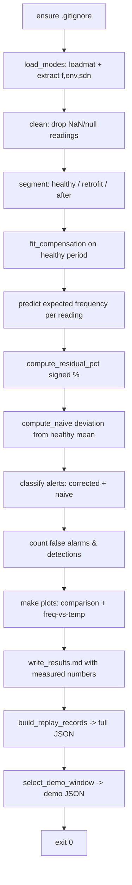

# Design Document

## Overview

The Trigger_Model is a single, explainable Python script that performs temperature-compensated structural trigger detection on the KW51 tracked-modes dataset. Bridge natural frequency drifts with temperature, so a naive "percent deviation from the mean" alert rule raises many false alarms during cold or hot weather. This feature fits a simple linear model of frequency on temperature over a known-healthy period, predicts the expected frequency for every reading, and flags readings whose temperature-corrected residual crosses configured thresholds.

The script `ml/trigger/trigger_model.py` runs end to end with `python ml/trigger/trigger_model.py` and produces five artifacts:

- `ml/trigger/plots/naive_vs_corrected.png` — a two-panel time-series comparison plot.
- `ml/trigger/plots/freq_vs_temp.png` — a healthy-period scatter with the fitted line.
- `ml/trigger/results.md` — a measured-numbers report (slope, intercept, R², counts).
- `data/trigger/replay_kw51.json` — the full replay feed in shared-contract format.
- `data/trigger/replay_kw51_demo.json` — a short demo window that crosses into warning/alarm.

Design priorities, in order: stay simple and explainable (hackathon context), report only real measured numbers, honor the file-ownership boundary (only `ml/trigger/`, `data/trigger/`, and the repo-root `.gitignore`), and preserve the shared replay JSON schema exactly.

**Open decision (Requirement 15).** The shared `docs/contract.md` section 2 shows absolute-residual thresholds of 2.0 / 5.0 / 8.0 and the example source label `"Z24 replay"`. This feature uses 0.75 / 1.5 / 2.0 and `"KW51 replay"`. The design treats the feature values as a **working assumption pending team confirmation**, keeps the thresholds as top-of-file named constants so a single edit resolves them, records the mismatch in a human-readable open-decision note (emitted into `ml/trigger/results.md`), and does **not** modify the shared contract. The nine-field replay schema itself is preserved exactly as the contract defines it.

### Requirements Traceability Summary

| Requirement | Addressed by |
| --- | --- |
| 1 — .gitignore config | `ensure_gitignore()`, Error Handling, Property 8 |
| 2 — dependency declaration | `ml/trigger/requirements.txt` (pinned), Components |
| 3 — dataset load/extract | `load_modes()`, Error Handling |
| 4 — period segmentation | `segment()`, Property 6 |
| 5 — compensation model | `fit_compensation()`, `predict()`, `compute_residual_pct()`, Property 5 |
| 6 — corrected alert levels | `classify()` + constants, Properties 1, 3 |
| 7 — naive baseline | `compute_naive()`, `classify()` reuse |
| 8 — comparison metrics | `count_false_alarms()`, `count_detections()` |
| 9 — comparison plot | `make_comparison_plot()` |
| 10 — freq-vs-temp plot | `make_fit_plot()` |
| 11 — results report | `write_results()`, Req 11.5 measured-only rule |
| 12 — full replay | `build_replay_records()`, `write_json()`, Properties 2, 3, 4 |
| 13 — demo replay | `select_demo_window()`, Property 7 |
| 14 — single runnable script | `main()`, exit codes |
| 15 — contract discrepancy | Open-decision note, constants, schema preservation |

## Architecture

The script is a single module organized as a linear pipeline of small, well-named, mostly pure functions. There is no API, no web framework, and no ML framework — just `numpy`, `pandas`, `scipy` (`scipy.io.loadmat`, `scipy.stats.linregress`), and `matplotlib`. Keeping the data flowing one direction through named stages is what makes the analysis explainable to a reviewer reading top to bottom.



Each stage either produces a value consumed by the next or writes an output artifact. Any precondition failure (missing file, empty data, degenerate fit) aborts the pipeline before the affected stage with a clear message and a non-zero exit, leaving existing outputs untouched. The fit stage and the classification stage are pure and deterministic, which is what makes the correctness properties below testable in isolation.

### Pipeline stage responsibilities

1. **Configure ignore file** — create or idempotently append the three required entries to the repo-root `.gitignore`.
2. **Load & extract** — read the `.mat`, build a tidy DataFrame of timestamp, temperature, frequency.
3. **Clean** — drop readings with any missing required value.
4. **Segment** — label each reading healthy / retrofit / after by date boundaries.
5. **Fit** — OLS regression of frequency on temperature over healthy readings only.
6. **Predict & residual** — expected frequency per reading; signed percent residual.
7. **Naive baseline** — percent deviation from healthy-mean frequency.
8. **Classify** — alert level from absolute metric, for both methods.
9. **Metrics** — false-alarm counts (healthy, both methods) and detection count (after, corrected).
10. **Plots** — comparison panels and fit scatter.
11. **Report** — measured slope/intercept/R², counts, and the open-decision note.
12. **Replay** — full records and a qualifying demo window, both in contract format.

## Components and Interfaces

A single module, `ml/trigger/trigger_model.py`. Function signatures below are conceptual (describing intent and data shape), not a frozen API.

### Top-of-file constants

```python
# --- Alert thresholds (WORKING ASSUMPTION, see Requirement 15 / open-decision note) ---
WATCH_THRESHOLD   = 0.75   # |metric| >= this -> watch
WARNING_THRESHOLD = 1.5    # |metric| >= this -> warning
ALARM_THRESHOLD   = 2.0    # |metric| >= this -> alarm

# --- Period boundaries ---
HEALTHY_END  = "2019-05-15"   # readings strictly before -> healthy
RETROFIT_END = "2019-09-27"   # readings through 23:59:59 this day -> retrofit; after -> after

# --- Fixed replay field values (shared contract section 2) ---
NODE_ID = "node-1"
QUALITY = "ok"
SOURCE  = "KW51 replay"       # WORKING ASSUMPTION vs contract "Z24 replay"

# --- Paths (all within owned directories) ---
RAW_PATH        = "ml/trigger/raw/trackedmodes.mat"
PLOTS_DIR       = "ml/trigger/plots"
RESULTS_PATH    = "ml/trigger/results.md"
REPLAY_PATH     = "data/trigger/replay_kw51.json"
DEMO_PATH       = "data/trigger/replay_kw51_demo.json"
GITIGNORE_PATH  = ".gitignore"
GITIGNORE_ENTRIES = ["ml/trigger/raw/", "__pycache__/", ".venv/"]
```

Thresholds and the source label are the only values touched by the open decision; keeping them as named constants means resolving Requirement 15 is a one-line edit.

### Functions

| Function | Signature (conceptual) | Responsibility | Requirements |
| --- | --- | --- | --- |
| `ensure_gitignore` | `ensure_gitignore(path, entries) -> None` | Create `.gitignore` with the three entries, or append only missing full-line entries; fix a missing trailing newline first; no-op if all present. | 1.1–1.4, 1.6 |
| `load_modes` | `load_modes(path) -> DataFrame[timestamp, temperature_c, frequency_hz]` | `loadmat(path, squeeze_me=True, struct_as_record=False)["modes"]`; convert `sdn` via `pd.to_datetime(sdn - 719529, unit="D")`; extract `f[:,5]`, `env[:,0]`; drop NaN/null rows. | 3.1–3.7 |
| `segment` | `segment(df) -> DataFrame (+ period column)` | Label each reading `healthy` / `retrofit` / `after` by `HEALTHY_END` and `RETROFIT_END`. | 4.1–4.4 |
| `fit_compensation` | `fit_compensation(healthy_df) -> (slope, intercept, r_squared)` | OLS of frequency on temperature over healthy readings via `scipy.stats.linregress`; `r_squared = result.rvalue ** 2`. Abort if < 2 healthy readings. | 5.1, 5.2, 11.2 |
| `predict` | `predict(df, slope, intercept) -> Series` | `predicted = slope * temperature_c + intercept` per reading. | 5.3 |
| `compute_residual_pct` | `compute_residual_pct(df) -> Series` | `(actual - predicted) / predicted * 100`; `NaN` (undefined) where `predicted == 0`. | 5.4, 5.5 |
| `compute_naive` | `compute_naive(df, healthy_mean) -> Series` | `(frequency_hz - healthy_mean) / healthy_mean * 100`. Abort if 0 healthy readings or `healthy_mean == 0`. | 7.1, 7.2 |
| `classify` | `classify(abs_metric) -> str` | Map an absolute metric to `normal`/`watch`/`warning`/`alarm` using the constants; `None`/NaN input is excluded (no level). | 6.1–6.6, 7.3 |
| `count_false_alarms` | `count_false_alarms(df, method) -> int` | Count healthy readings with alert above `normal` for the given method (naive or corrected). | 8.1, 8.2, 8.4 |
| `count_detections` | `count_detections(df) -> int` | Count after-period readings with corrected alert above `normal`. | 8.3, 8.4 |
| `make_comparison_plot` | `make_comparison_plot(df, path) -> None` | Two stacked panels over time (naive upper, corrected lower); ± threshold lines; gray retrofit shading. | 9.1–9.5 |
| `make_fit_plot` | `make_fit_plot(healthy_df, slope, intercept, path) -> None` | Scatter freq vs temp (healthy); overlay fitted line across healthy temp range. | 10.1–10.4 |
| `write_results` | `write_results(stats, counts, path) -> None` | Write `results.md`: slope/intercept/R² (3 dp), false-alarm counts, detection count, open-decision note; measured values only. | 11.1–11.5, 15.2, 15.3 |
| `build_replay_records` | `build_replay_records(df) -> list[dict]` | One nine-field record per analyzed reading, ascending timestamp; fixed values; ISO-8601 UTC `Z`; 3-dp rounding; signed residual. | 12.1–12.7 |
| `select_demo_window` | `select_demo_window(records) -> list[dict]` | Pick a contiguous 1–7 day window transitioning normal → warning/alarm; error if none. | 13.1–13.4 |
| `write_json` | `write_json(records, path) -> None` | Serialize a record list to JSON array; empty list → `[]`. | 12.1, 12.2, 13.1 |
| `main` | `main() -> int` | Orchestrate the pipeline; return 0 on full success, non-zero on any abort. | 14.1–14.3 |

### How the fit is done

`fit_compensation` performs an ordinary-least-squares linear regression of Mode_6_Frequency (dependent) on Steel_Temperature (independent) using only Healthy_Period readings (`scipy.stats.linregress(temperature_c, frequency_hz)`). It returns `slope`, `intercept`, and `r_squared = rvalue ** 2`. The model then predicts expected frequency for *every* reading (all three periods) from that reading's temperature, so retrofit and after readings are judged against the behavior the bridge showed while healthy. Residuals express how far the measured frequency sits from that temperature-adjusted expectation, as a signed percentage. A guard rejects a healthy period with fewer than 2 readings before fitting, and a separate guard rejects a zero/empty healthy mean before the naive baseline.

### `classify` boundary semantics

`classify` takes the absolute value of a metric and returns the level using half-open intervals: `[0, 0.75) → normal`, `[0.75, 1.5) → watch`, `[1.5, 2.0) → warning`, `[2.0, ∞) → alarm`. Both the corrected residual and the naive deviation use the same function and thresholds, which is what makes the two methods directly comparable. Readings whose residual is undefined (predicted frequency 0) are excluded from classification rather than defaulting to `normal`.

## Data Models

### Internal DataFrame

After loading and cleaning, the working DataFrame carries these columns:

| Column | Type | Source / meaning |
| --- | --- | --- |
| `timestamp` | `datetime64[ns]` (UTC) | `pd.to_datetime(sdn - 719529, unit="D")` |
| `temperature_c` | `float` | `modes.env[:, 0]`, steel temperature °C |
| `frequency_hz` | `float` | `modes.f[:, 5]`, mode-6 natural frequency Hz |

Pipeline stages add derived columns: `period` (`healthy`/`retrofit`/`after`), `predicted_frequency_hz` (float), `residual_pct` (float, NaN where undefined), `naive_pct` (float), `alert_level` (str or excluded), `naive_alert_level` (str).

### Replay record object

Each replay record is a JSON object with **exactly** these nine fields, in this order, and no others (shared contract section 2):

| Field | Type | Value / rule |
| --- | --- | --- |
| `node_id` | string | fixed `"node-1"` |
| `timestamp` | string | ISO-8601 UTC with trailing `Z`, e.g. `2019-01-17T10:00:00Z` |
| `temperature_c` | number | measured °C, rounded to ≤ 3 decimals |
| `frequency_hz` | number | measured Hz, rounded to ≤ 3 decimals |
| `predicted_frequency_hz` | number | model prediction Hz, rounded to ≤ 3 decimals |
| `residual_pct` | number | **signed** percent residual, rounded to ≤ 3 decimals |
| `alert_level` | string enum | one of `normal` \| `watch` \| `warning` \| `alarm` |
| `quality` | string | fixed `"ok"` |
| `source` | string | fixed `"KW51 replay"` (working assumption) |

Example record (same shape as `web/src/mocks/replay_z24.json` and contract section 2; feature values shown):

```json
{
  "node_id": "node-1",
  "timestamp": "2019-01-17T10:00:00Z",
  "temperature_c": 4.2,
  "frequency_hz": 4.04,
  "predicted_frequency_hz": 4.05,
  "residual_pct": -0.247,
  "alert_level": "normal",
  "quality": "ok",
  "source": "KW51 replay"
}
```

Both replay files (`replay_kw51.json`, `replay_kw51_demo.json`) are JSON arrays of these records, ordered by ascending timestamp. The full file contains one record per analyzed reading (readings with undefined residual are excluded from analysis and therefore absent). An empty analysis yields `[]`.

### `results.md` shape

A short Markdown report with: a title, a measured-statistics block (slope, intercept, R² to 3 dp), a counts block (healthy false alarms under naive and corrected; after-period detections under corrected), and an **Open Decisions** section carrying the Requirement 15 note (threshold mismatch 0.75/1.5/2.0 vs 2.0/5.0/8.0; source `"KW51 replay"` vs `"Z24 replay"`; treated as working assumption pending team confirmation). Every number is computed from the current run; no templated or stand-in values.

## Correctness Properties

*A property is a characteristic or behavior that should hold true across all valid executions of a system — essentially, a formal statement about what the system should do. Properties serve as the bridge between human-readable specifications and machine-verifiable correctness guarantees.*

The prework analysis classified each acceptance criterion as PROPERTY, EXAMPLE, EDGE_CASE, INTEGRATION, or SMOKE. The testable universal behaviors (pure functions: classification, residual sign, segmentation, record construction, window selection, ignore-file transform, cleaning) became the properties below. Rendering, orchestration, static-content, and provenance criteria are covered by unit/integration/smoke tests in the Testing Strategy instead. Redundant criteria were consolidated (e.g., the four `classify` thresholds into one boundary property; the schema criterion 12.3 and 15.1 into one nine-field property; the two demo-window criteria into one).

### Property 1: classify is boundary-correct and monotonic

*For any* finite metric value `m`, `classify(abs(m))` returns `normal` when `|m| ∈ [0, 0.75)`, `watch` when `|m| ∈ [0.75, 1.5)`, `warning` when `|m| ∈ [1.5, 2.0)`, and `alarm` when `|m| ∈ [2.0, ∞)`; and the assigned severity never decreases as `|m|` increases.

**Validates: Requirements 6.1, 6.2, 6.3, 6.4, 6.5, 7.3**

### Property 2: residual sign matches actual-minus-predicted

*For any* reading with predicted frequency `> 0`, the sign of `residual_pct` equals the sign of `(actual - predicted)` (and is zero exactly when `actual == predicted`).

**Validates: Requirements 5.4**

### Property 3: undefined residuals are excluded from classification

*For any* reading whose predicted frequency is 0 (residual undefined), the reading is assigned no `alert_level` under the corrected model — it is excluded rather than defaulted to `normal`.

**Validates: Requirements 5.5, 6.6**

### Property 4: period segmentation partitions all readings

*For any* set of retained readings, every reading is assigned to exactly one of `healthy` (timestamp strictly before 2019-05-15 00:00:00), `retrofit` (2019-05-15 00:00:00 through 2019-09-27 23:59:59 inclusive), or `after` (strictly after 2019-09-27 23:59:59), and the three periods are mutually exclusive and jointly cover every retained reading.

**Validates: Requirements 4.1, 4.2, 4.3, 4.4**

### Property 5: NaN cleaning drops exactly the incomplete readings

*For any* loaded DataFrame, after cleaning no retained reading has a null/NaN timestamp, temperature, or frequency, and every reading with all three required values present is retained.

**Validates: Requirements 3.5, 3.7**

### Property 6: every replay record has exactly the nine contract fields

*For any* set of analyzed readings, each produced replay record has a key set exactly equal to `{node_id, timestamp, temperature_c, frequency_hz, predicted_frequency_hz, residual_pct, alert_level, quality, source}` — no missing and no extra fields.

**Validates: Requirements 12.3, 15.1**

### Property 7: fixed replay fields hold constant values

*For any* replay record (full or demo), `node_id == "node-1"`, `quality == "ok"`, and `source == "KW51 replay"`.

**Validates: Requirements 12.4**

### Property 8: replay timestamps are ISO-8601 UTC with trailing Z

*For any* replay record, `timestamp` matches the ISO-8601 UTC pattern ending in `Z` and parses back to the same instant as the source reading's timestamp.

**Validates: Requirements 12.5**

### Property 9: alert_level is always one of the four enum strings

*For any* replay record, `alert_level ∈ {"normal", "watch", "warning", "alarm"}`.

**Validates: Requirements 12.6**

### Property 10: replay numeric fields are rounded to at most 3 decimals

*For any* replay record, each of `temperature_c`, `frequency_hz`, `predicted_frequency_hz`, and `residual_pct` equals its value rounded to 3 decimal places, and `residual_pct` retains the sign of the underlying signed residual.

**Validates: Requirements 12.7**

### Property 11: the full replay is ordered and complete

*For any* set of analyzed readings, the full replay array is sorted by ascending timestamp and contains exactly one record per analyzed reading (and `[]` when there are none).

**Validates: Requirements 12.1, 12.2**

### Property 12: the demo window is contiguous and crosses into alert

*For any* reading series that contains a qualifying window, the selected demo window is a contiguous run of consecutive readings in ascending timestamp order with no interior reading omitted, spans between 1 and 7 days inclusive, and contains an earlier reading at `alert_level == "normal"` followed by a later reading at `alert_level ∈ {"warning", "alarm"}`.

**Validates: Requirements 13.2, 13.3**

### Property 13: .gitignore append is idempotent and preserving

*For any* starting `.gitignore` content, after applying the ignore-configuration transform all three entries (`ml/trigger/raw/`, `__pycache__/`, `.venv/`) appear as exact full-line matches, every pre-existing line is preserved unchanged, no entry is concatenated onto another line, and applying the transform a second time produces identical content (idempotence).

**Validates: Requirements 1.1, 1.2, 1.3, 1.4**

## Error Handling

The pipeline fails fast: each precondition is checked before the stage that depends on it, and any failure prints a clear message to stderr and exits non-zero (Requirement 14.3), leaving existing outputs untouched.

| Condition | Detection point | Behavior | Requirements |
| --- | --- | --- | --- |
| `.mat` file missing, unreadable, or no `modes` struct | `load_modes` | Abort with a message identifying the missing/invalid dataset; non-zero exit. | 3.6 |
| No readings remain after dropping NaN/null | after cleaning | Abort with a "no usable data" message. | 3.7 |
| Healthy period has < 2 readings | before `fit_compensation` | Abort with an "insufficient healthy readings to fit model" message. | 5.2 |
| Predicted frequency == 0 for a reading | `compute_residual_pct` | Mark that reading's residual undefined (NaN); exclude it from alert assignment; do not crash. | 5.5, 6.6 |
| 0 healthy readings or healthy mean == 0 | before `compute_naive` | Abort with a "healthy mean frequency unavailable" message. | 7.2 |
| Plot file cannot be written | `make_comparison_plot` / `make_fit_plot` | Abort identifying the specific plot path; preserve any existing file. | 9.5, 10.4 |
| Any required output target cannot be written | the writing function | Abort, preserve the existing state of that target, report the target. | 1.6 |
| No qualifying demo window exists | `select_demo_window` | Report an error that no qualifying demo window was found; non-zero exit. | 13.4 |
| No analyzed readings (empty, but not an error upstream) | `write_json` for full replay | Write the full replay as an empty JSON array `[]`. | 12.2 |
| `.gitignore` missing trailing newline while appending | `ensure_gitignore` | Insert a newline before the first appended entry so no entry joins an existing line. | 1.3 |
| All three ignore entries already present | `ensure_gitignore` | Make no change to the file. | 1.4 |

Ownership boundary (Requirement 1.5): all writable paths are fixed constants under `ml/trigger/`, `data/trigger/`, or the repo-root `.gitignore`. The script never writes outside this set; in particular it never modifies `docs/contract.md` (Requirements 15.4, 15.5).

## Testing Strategy

This feature is a set of pure data transformations (classification, residual math, segmentation, record construction, window selection, ignore-file editing) with thin I/O and rendering layers around them. That pure core is well suited to property-based testing, so the strategy is dual: property tests for the universal behaviors, and example/integration/smoke tests for the glue, rendering, orchestration, and static artifacts.

### Test layout

A `pytest` module under `ml/trigger/tests/` (for example `ml/trigger/tests/test_trigger_model.py`), using **`hypothesis`** for the property tests. Fixtures provide either an in-memory DataFrame of synthetic readings or a tiny synthetic `.mat` file built with `scipy.io.savemat` containing a `modes` struct with `sdn`, `f`, and `env`, so loading and extraction can be exercised without the real raw dataset. `hypothesis` and `pytest` are dev-only tools and are not added to the runtime `requirements.txt`.

### Property-based tests

- **Library:** `hypothesis` (do not hand-roll generators/shrinking).
- **Iterations:** each property test runs a minimum of 100 generated examples (`@settings(max_examples=100)` or higher).
- **Traceability:** each test carries a comment tagging its design property, format:
  `# Feature: trigger-model, Property {number}: {property_text}`
- **Mapping:** one property-based test per correctness property (Properties 1–13). Generators: metric floats spanning the threshold boundaries (incl. exact 0.75/1.5/2.0) for Property 1; actual/predicted pairs with predicted > 0 for Property 2; predicted == 0 rows for Property 3; timestamps straddling both boundary dates for Property 4; frames with randomly injected NaNs for Property 5; synthetic reading sets for Properties 6–11; series containing a constructed normal→alarm run for Property 12; arbitrary text with random subsets of the three entries for Property 13.

### Example-based unit tests

Focused concrete cases for behavior that does not vary meaningfully with input: `classify` constant imports equal 0.75/1.5/2.0 (6.1); `sdn` datenum → known date (3.2); `f[:,5]`/`env[:,0]` extraction on a known fixture (3.3, 3.4); known-line healthy points → recovered slope/intercept with non-healthy excluded (5.1, 5.3); known mean/freq → naive value (7.1); small labeled frames → expected false-alarm/detection counts (8.1–8.3); `results.md` contains the computed slope/intercept/R² at 3 dp and the counts, and the values equal the stats passed in rather than any literal (11.1–11.5); `results.md` contains both discrepancy statements and the working-assumption note (15.2, 15.3).

### Edge-case tests

Healthy period with 0 and 1 readings aborts before fit (5.2); empty/zero healthy mean aborts before naive (7.2); empty period counts are 0 (8.4); empty analysis yields `[]` (12.2); series with no normal→alert transition triggers the no-demo-window error (13.4); missing `.mat` and a struct-less `.mat` abort (3.6); all-NaN input aborts with no-usable-data (3.7).

### Rendering / write-failure tests

Run `make_comparison_plot` and assert the file is created with two stacked axes and threshold lines, and that the retrofit span is shaded (9.1–9.4); run `make_fit_plot` and assert the scatter plus fitted line and file creation (10.1–10.3); mock a write failure (e.g., patch `savefig`/`open` to raise) and assert the script aborts identifying the target and preserves existing state (9.5, 10.4, 1.6).

### Integration / smoke tests

Run `main()` on the synthetic `.mat` fixture end to end and assert exit status 0 with all five artifacts written (14.1, 14.2); inject a failure and assert a non-zero exit (14.3). Smoke-check that `requirements.txt` lists `numpy`, `pandas`, `scipy`, `matplotlib`, each pinned with `==` (2.1, 2.2). Static-assert the write-path set lies within owned directories and excludes `docs/contract.md` (1.5, 15.4, 15.5). Dependency-resolution failure (2.3) and real-pip behavior are out of unit scope and left to the installer.

### Measured-numbers discipline

Per Requirement 11.5, the generated `results.md` contains only numbers computed from the current run. Tests assert that report values equal the computed statistics passed into `write_results`; they do **not** assert those statistics equal specific hardcoded magnitudes, because the real slope, intercept, R², and counts are measured from the dataset and must not be pinned to invented values.
