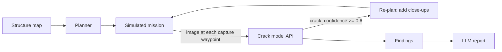

# InspectPath

The planning and analysis brain for an inspection robot. It plans an efficient route over a structure map, simulates the mission, spots cracks with our own trained model, and writes up what it found.

Built for Hackachusetts 2026, Track 02: Robotics & Hardware.

> Screenshot / GIF: TO FILL

> **Simulation with real defect images. AI severity is an estimate, not an engineering rating.**

## The problem

Inspecting bridges and tunnels is slow, expensive and dangerous. Robots can help, but they produce a flood of images that someone still has to sift through. Battery life also limits how much a robot can cover, so the route matters.

## What it does

- **Route planning:** covers priority zones first, within a battery budget.
- **Simulated mission:** the robot "captures" an image at each capture waypoint.
- **Crack detection:** our own trained classifier checks every image.
- **Adaptive close-ups:** when a likely crack is found, the plan is updated to take close-up shots.
- **Inspection report:** an LLM writes a mapped report from the real findings only.

## How it works



1. A structure is a 2D grid with surface, obstacles and priority zones.
2. The planner builds a route within the battery budget (move = 1, capture = 1).
3. The dashboard walks the route and sends each captured image to the model API.
4. If the model says "crack" with confidence of 0.6 or more, close-up waypoints are added and the rest of the route is re-planned.
5. All findings go to the LLM, which writes the report. A template fallback is used if the LLM is unavailable.

## Results

Numbers here are copied from real runs only. Nothing is estimated.

**Planner (naive vs optimized):** TO FILL from the planner test output.

**Crack model (held-out test set):** TO FILL from `ml/results.md`.

## How to run it

Prerequisites: Node.js, Python 3.10+.

```bash
# Frontend (once web/ is set up)
cd web
npm install && npm run dev

# Model API (once ml/api/ is set up)
cd ml/api
pip install -r requirements.txt
uvicorn main:app --reload

# Model API in mock mode (no trained model needed)
MOCK_MODEL=1 uvicorn main:app --reload
```

- **Fake-data mode:** the dashboard can run entirely from `data/fake/` without the model API.
- **Environment variables:** copy `.env.example` to `.env` and fill in values locally. Never commit `.env` or real keys.

## Repo structure

```
inspectpath/
├── .kiro/
│   ├── specs/      Requirements, design and tasks for each feature
│   ├── steering/   Project rules and the data contract
│   └── hooks/      Automations that run on file events
├── web/            Dashboard (React + Vite)
│   └── src/planner/  Coverage planner and re-planning
├── ml/             Model training and evaluation
│   └── api/        Inference API (/predict, /health)
├── data/
│   ├── structures/ Structure grids (bridge, tunnel)
│   └── images/     Demo images mapped to waypoints
├── docs/readme/    Per-area README sections
├── embedded/       Stretch work only
├── .env.example    Variable names only
└── README.md
```

## Limitations

- 2D simulation. No flight dynamics, and movement is 4-directional.
- Public-dataset images are mapped onto simulated waypoints.
- AI severity is an estimate, not an engineering rating.
- One dataset and no field validation.
- Not a replacement for engineers or engineering-standard inspections.

## How we used Kiro

TO FILL: spec mode, steering files and hooks, and why we used each one. See the [`.kiro/`](.kiro/) folder.

## Team

- **Suhail:** product lead, integration, web UI, LLM report, README, video.
- **Varun:** robotics, structures, planner, re-planning.
- **Zaiba:** ML model, evaluation, inference API.
- **Komal:** demo image set, waypoint mapping, localization/severity stretch.

## Next steps

- Live drone or crawler camera feed.
- More defect types, such as corrosion and spalling.
- Field data.
- Alignment with real inspection standards.

## Dataset and credits

Dataset: TO FILL (name and link; not committed to this repo).

Libraries: TO FILL.

## License

See [LICENSE](LICENSE).
