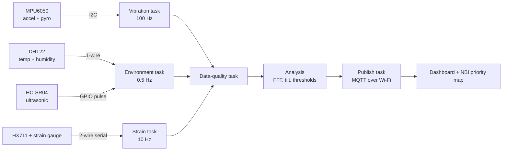

**Document** Hardware specification, rev. A **Author** Varun Tushar Gharat **Platform** ESP32-DevKitC V4 (Wokwi simulation)

# Bridge structural health monitoring node

A low-cost sensor node that measures how a bridge vibrates, tilts, carries load and sits above the water, checks every reading for quality on the device, and reports whether the structure is behaving as it did when the node was installed.

## Why this node exists: Massachusetts bridges by lowest condition rating

Each bridge is counted by the worst of its deck, superstructure and substructure ratings in the 2022 National Bridge Inventory (0 = failed, 9 = excellent). Ratings of 4 or below are “poor” and are highlighted. Culverts rated “N” (324) are not shown.

FailedPoor ≤ 4Excellent

**435**bridges rated poor or worse

**179+**of those cross a river or brook

**1954**median year built (poor bridges)

**293**of the 435 are steel

1. [1. Overview](#overview)
2. [2. System architecture](#architecture)
3. [3. Bill of materials](#bom)
4. [4. Sensor specifications](#sensors)
5. [5. Pin assignment](#pins)
6. [6. Power](#power)
7. [7. Parameters and safety rationale](#parameters)
8. [8. Data quality checks](#quality)
9. [9. Alert levels](#alerts)
10. [10. Firmware tasks](#firmware)
11. [11. Limitations and upgrade path](#limits)

## 1Overview

Bridges in the United States are inspected visually, generally at least every 24 months. Between inspections, a bridge can lose stiffness, settle at a pier, or have its foundations eroded by floodwater without anyone seeing it. This node fills that gap with continuous measurement.

The node does not decide on its own that a bridge is unsafe. It establishes a baseline of normal behavior after installation, then watches for changes that engineers associate with damage, and raises graded alerts so inspectors know which bridges to visit first.

### Design goals

- Measure the four failure-relevant quantities: dynamic response, rotation, strain and water level.
- Compensate for temperature, the largest source of false alarms in vibration monitoring.
- Validate every reading on the device, so bad data is flagged where it is captured instead of corrupting the analysis later.
- Use only parts that cost a few dollars each and run on a single ESP32.

## 2System architecture

Sensors feed separate FreeRTOS tasks. All readings pass through a data-quality stage before analysis, and only validated, flagged records are published over Wi-Fi.

## 3Bill of materials

| Ref | Part | Function | Interface | Supply |
| --- | --- | --- | --- | --- |
| U1 | ESP32-DevKitC V4 (ESP32-WROOM-32E) | Controller, Wi-Fi uplink | n/a | USB 5 V, 3.3 V on board |
| U2 | MPU6050 breakout | Vibration and tilt | I2C, 0x68 | 3.3 V |
| U3 | DHT22 (AM2302) | Air temperature and humidity | Single-wire | 3.3 V |
| U4 | HC-SR04 | Distance to water surface | TRIG / ECHO pulse | 5 V |
| U5 | HX711 module | 24-bit ADC for strain gauge bridge | DT / SCK serial | 3.3 V |
| SG1 | Strain gauge in a Wheatstone bridge (load cell in simulation) | Beam strain | Analog to U5 | Excitation from U5 |
| R1, R2 | 1 kΩ and 2 kΩ resistors | Divide 5 V ECHO to 3.3 V | n/a | n/a |

## 4Sensor specifications

Figures are typical datasheet values for each part.

### ESP32-DevKitC V4

Controller. Runs the sampling, quality checks, FFT and Wi-Fi uplink.

Processor

Dual-core Xtensa LX6, up to 240 MHz

Memory

520 KB SRAM, 4 MB flash (WROOM-32E module)

Wireless

Wi-Fi 802.11 b/g/n, Bluetooth

Logic level

3.3 V; GPIOs are not 5 V tolerant

Why chosen

Native FreeRTOS, two cores (one dedicated to the FFT), and built-in Wi-Fi for publishing results.

### MPU6050 accelerometer and gyroscope

Measures how the structure vibrates and whether it is rotating.

Accelerometer range

±2, ±4, ±8 or ±16 g (±2 g used for best resolution)

Gyroscope range

±250 to ±2000 °/s

Resolution

16-bit ADC per axis

Output rate

Accelerometer up to 1 kHz, with a configurable low-pass filter

Interface

I2C up to 400 kHz, address 0x68 (AD0 low)

Why chosen

Gives both dynamic vibration (for natural frequency) and static gravity direction (for tilt) from one part.

### DHT22 temperature and humidity

Provides the temperature needed to correct the other sensors, plus corrosion and freeze-thaw indicators.

Temperature

−40 to 80 °C, ±0.5 °C

Humidity

0 to 100 % RH, ±2 to 5 % RH

Sample rate

One reading every 2 s at most

Interface

Single-wire digital with checksum

Why chosen

Temperature drives frequency shifts, thermal expansion and the speed of sound used by the ultrasonic sensor.

### HC-SR04 ultrasonic rangefinder

Mounted under the deck, pointing down, to measure the distance to the water surface.

Range

2 to 400 cm

Resolution

About 3 mm

Beam

40 kHz, about 15° cone

Interface

10 µs TRIG pulse; ECHO pulse width is proportional to distance

Why chosen

Tracks water level and its rate of rise, the conditions under which scour happens.

### HX711 with strain gauge

Measures how much a beam stretches as traffic crosses.

ADC

24-bit, programmable gain of 128 or 64 (channel A)

Sample rate

10 or 80 samples per second

Supply

2.6 to 5.5 V

Interface

Two-wire serial (DT data, SCK clock)

Why chosen

Strain gauge signals are microvolts; the HX711 amplifies and digitizes them directly. Wokwi models it with a load cell.

## 5Pin assignment

All pins avoid the ESP32’s strapping pins (0, 2, 5, 12, 15), the flash pins (6 to 11) and the input-only pins (34 to 39), so the same wiring works on real hardware.

| Sensor | Sensor pin | ESP32 pin | Notes |
| --- | --- | --- | --- |
| MPU6050 | VCC / GND | 3V3 / GND |  |
| SDA | GPIO21 | Arduino core default I2C data |  |
| SCL | GPIO22 | Arduino core default I2C clock |  |
| AD0 / INT | Unconnected | Address 0x68; sampling is timed by FreeRTOS |  |
| DHT22 | VCC / GND | 3V3 / GND |  |
| Data (SDA in Wokwi) | GPIO4 | Add a 10 kΩ pull-up on real hardware |  |
| HC-SR04 | VCC / GND | 5V / GND |  |
| TRIG | GPIO26 | Output, 3.3 V is enough to trigger |  |
| ECHO | GPIO27 | Through the R1/R2 divider on real hardware |  |
| HX711 | VCC / GND | 3V3 / GND |  |
| DT | GPIO32 | Data out |  |
| SCK | GPIO33 | Clock in |  |

## 6Power

The board is powered over USB. The 3.3 V rail feeds the MPU6050, DHT22 and HX711; the 5 V pin feeds the HC-SR04.

| Load | Typical current |
| --- | --- |
| ESP32 with Wi-Fi transmitting | 160 to 260 mA peak |
| HC-SR04 during a ping | about 15 mA |
| MPU6050 | about 4 mA |
| DHT22 while measuring | about 1.5 mA |
| HX711 | about 1.5 mA |

### Level shifting the ECHO line

The HC-SR04 drives ECHO at 5 V, which can damage an ESP32 input. A resistor divider brings it into range:

V_out = 5 V × R2 / (R1 + R2) = 5 V × 2 kΩ / 3 kΩ ≈ 3.33 V

Wokwi does not model this, so the simulation connects ECHO directly.

## 7Parameters and safety rationale

This section explains what each measurement says about whether the structure is safe. Every threshold below is a demonstration value relative to the node’s own baseline. Real limits are set by a structural engineer for each bridge.

### 7.1 Natural frequency MPU6050, 100 Hz, FFT

A bridge vibrates at natural frequencies set by its stiffness and mass. Cracks, corroded sections and failing connections reduce stiffness, so the natural frequency drops. This is the core idea behind vibration-based structural health monitoring.

f = (1 / 2π) × √(k / m) A 10 % loss of stiffness k lowers f by about 5 %.

**How it is measured.** Traffic and wind excite the bridge continuously. The node samples vertical acceleration at 100 Hz, giving a usable band up to 50 Hz (the Nyquist limit). The first vertical modes of short and medium-span bridges usually fall between 1 and 10 Hz, well inside that band. A 1024-point FFT with a Hann window covers 10.24 s of data and resolves frequency to about 0.1 Hz. The highest peak in the 1 to 20 Hz band is taken as the first mode.

**Why temperature must be corrected.** Stiffness also changes with temperature. Seasonal swings can shift frequencies by several percent, which is as large as the change caused by real damage. Frozen supports make the bridge stiffer still. The node records frequency alongside temperature during the baseline period, fits a straight line, and compares each new reading with the value predicted for the current temperature.

**Demo thresholds.** Watch at a 2 % drop from the temperature-corrected baseline, Warning at 5 %, Alarm at 8 % or a sudden step change.

### 7.2 Vibration amplitude MPU6050, RMS and peak

A bridge that shakes more than it used to under similar traffic may have lost stiffness or damping, or have a loose bearing or joint. High vibration also matters for user comfort and fatigue of steel members.

**How it is measured.** The node computes the RMS and peak of vertical acceleration over each 10 s window, with gravity removed.

**Demo thresholds.** Watch when RMS exceeds 1.5× its baseline average, Warning at 2×. Single peaks are logged but do not raise alerts on their own, since one heavy truck can cause them.

### 7.3 Tilt MPU6050 accelerometer, averaged

A pier that is settling or being undermined by scour rotates slowly. Tilt is one of the few signs of foundation trouble that can be measured from above the waterline.

pitch = atan2(a_x, √(a_y² + a_z²)) roll = atan2(a_y, a_z)

**How it is measured.** Tilt comes from the direction of gravity, so vibration must be removed first. The node averages 10 s of accelerometer data, then computes pitch and roll. The gyroscope is not used for static tilt because its output drifts over time.

**Demo thresholds.** Change from the installed baseline of 0.25° for Watch, 0.5° for Warning and 1° for Alarm.

### 7.4 Strain HX711 and strain gauge, 10 Hz

Strain shows how hard a member is working. Rising peak strain under normal traffic means the member is carrying more load than before, often because a neighboring member has lost capacity. Repeated strain cycles also drive fatigue cracking in steel, and most of Massachusetts’ poor-condition bridges are steel.

ε = ΔL / L (reported in microstrain, µε) σ = E × ε with E ≈ 200 GPa for steel 100 µε ≈ 20 MPa of stress Yield of common A36 steel ≈ 250 MPa ≈ 1250 µε

**How it is measured.** A strain gauge is bonded to the beam in a Wheatstone bridge, which turns microscopic stretching into a microvolt signal. The HX711 amplifies it at gain 128 and digitizes it at 10 samples per second. The node records peak strain and counts load cycles in each window.

**Demo thresholds.** Watch when peak strain exceeds 1.3× the baseline peak, Warning at 30 % of the yield-equivalent strain, Alarm at 50 %.

### 7.5 Water level and rate of rise HC-SR04, every 2 s

Scour, the erosion of riverbed material around piers and abutments during high flow, is the most common cause of highway bridge failure in the United States. It happens fastest during floods, so water level and how quickly it is rising are direct indicators of scour risk.

speed of sound c ≈ 331.3 + 0.606 × T (m/s, T in °C) distance d = c × t_echo / 2 water level = mount height − d

**How it is measured.** The node takes five pings and uses the median, which rejects echoes from debris or ripples. The speed of sound uses the DHT22 temperature: without that correction, a 30 °C swing changes the reading by about 5 %, roughly 15 cm at a 3 m mount height.

**Demo thresholds.** Watch when the level is 0.5 m above its baseline, Warning at 1 m or a rise faster than 0.3 m per hour, Alarm at the bridge’s documented flood stage.

### 7.6 Temperature and humidity DHT22, every 2 s

Besides correcting the other sensors, the environment itself damages bridges. Freeze-thaw cycles crack concrete, and long periods of wetness corrode steel.

Thermal expansion: ΔL = α × L × ΔT steel α ≈ 12 × 10⁻⁶ /°C A 30 m steel span over a 40 °C seasonal swing moves about 14 mm.

**How it is measured.** The node counts freeze-thaw cycles (each time temperature crosses 0 °C and back) and accumulates time-of-wetness, the hours with humidity above 80 % and temperature above 0 °C, a standard corrosion indicator. These are reported as trends, not alarms.

## 8Data quality checks

A sensor that fails can look exactly like a bridge that fails. Every reading passes these checks before analysis, and each record carries a quality flag so the dashboard can show which data to trust.

| Check | Detects | Rule |
| --- | --- | --- |
| Range | Saturated or impossible values | Outside the sensor’s rated range, or acceleration at full scale |
| Stuck value | Frozen sensor or bus | The same value for 50 consecutive samples |
| Rate of change | Spikes and glitches | A jump larger than physically plausible between two samples |
| Dropout | Missing readings | I2C error, DHT22 checksum failure or no ECHO within 38 ms |
| Timing jitter | Uneven sampling that would distort the FFT | Sample interval more than 10 % away from 10 ms |
| Cross-check | Disagreement between sensors | A frequency drop explained by a matching temperature rise is not treated as damage |

A window with more than 5 % flagged samples is excluded from the FFT and from alert decisions, and the dashboard reports the node as degraded rather than reporting the bridge as unsafe.

## 9Alert levels

**Normal**All parameters within baseline limits.

**Watch**One parameter drifting. Logged and trended.

**Warning**One parameter past its warning limit, or two at Watch. Inspection should be scheduled.

**Alarm**Any parameter past its alarm limit. Immediate notification.

Combining parameters is what makes the alerts meaningful. A frequency drop together with rising strain and new tilt points strongly to structural change. A frequency drop alone during a heat wave points to temperature. The dashboard shows each node’s level next to the bridge’s NBI condition rating, so a poor-rated bridge with a Warning goes to the top of the inspection list.

## 10Firmware tasks

| Task | Core | Priority | Period | Job |
| --- | --- | --- | --- | --- |
| Vibration | 1 | High | 10 ms | Read MPU6050 with `vTaskDelayUntil`, timestamp, queue |
| Strain | 1 | Medium | 100 ms | Read HX711, queue |
| Environment | 1 | Low | 2 s | Read DHT22, five HC-SR04 pings, queue |
| Data quality | 1 | Medium | On data | Apply section 8 checks, set flags |
| Analysis | 0 | Medium | 10 s window | FFT, RMS, tilt, strain peaks, alert level |
| Publish | 0 | Low | 10 s | MQTT JSON record; serial output protected by a mutex |

Sampling runs on core 1 and the FFT and Wi-Fi run on core 0, so a slow network or a long FFT never delays a sample.

## 11Limitations and upgrade path

| Prototype part | Limitation | Field replacement |
| --- | --- | --- |
| MPU6050 | Noise is high for the small vibrations of a large bridge | Low-noise MEMS accelerometer such as the ADXL355 |
| DHT22 | Not designed for long outdoor exposure | Sealed DS18B20 probe for temperature, with a housed humidity sensor |
| HC-SR04 | Not waterproof; measures the water surface, not the riverbed | JSN-SR04T for water level; an underwater sonar for direct scour depth |
| Load cell | Stands in for a strain gauge in simulation | Weldable foil strain gauges with temperature compensation |
| USB power | Not available at most bridges | Solar panel and battery with deep sleep between windows |

**Scope of this node.** It is a screening tool that ranks bridges for attention between inspections. It does not replace inspection by qualified engineers, and its thresholds are demonstration values, not engineering limits.

Bridge condition data: FHWA National Bridge Inventory 2022, Massachusetts. Prepared by Varun Tushar Gharat for Hackachusetts, Robotics track: safer inspection of critical infrastructure.